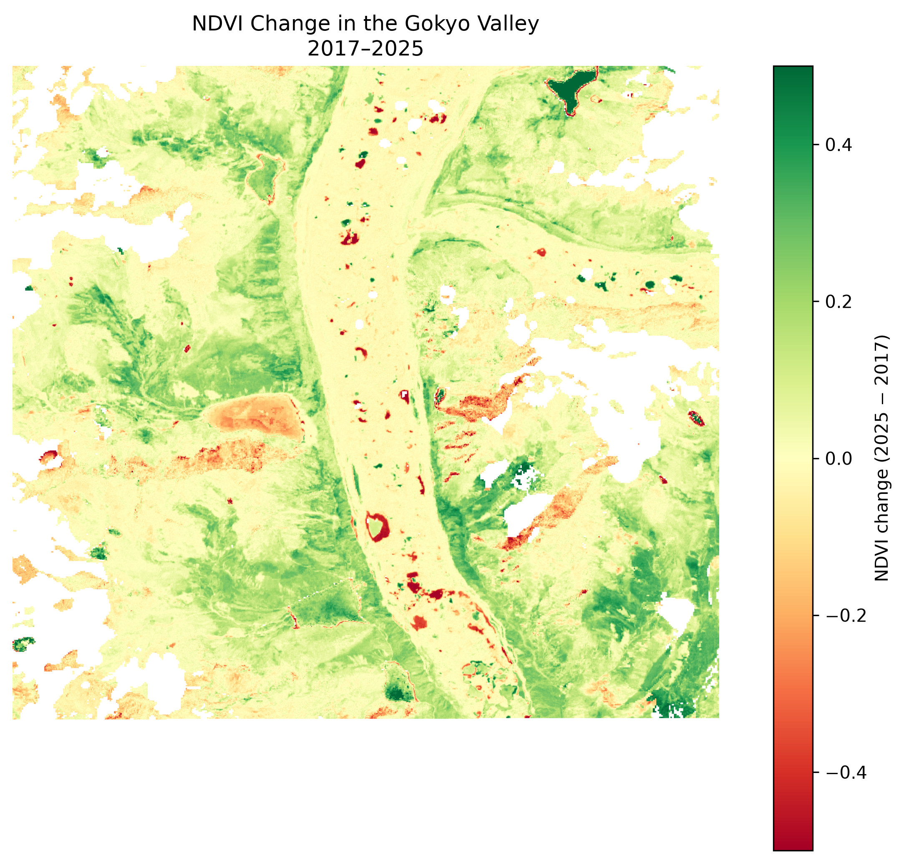
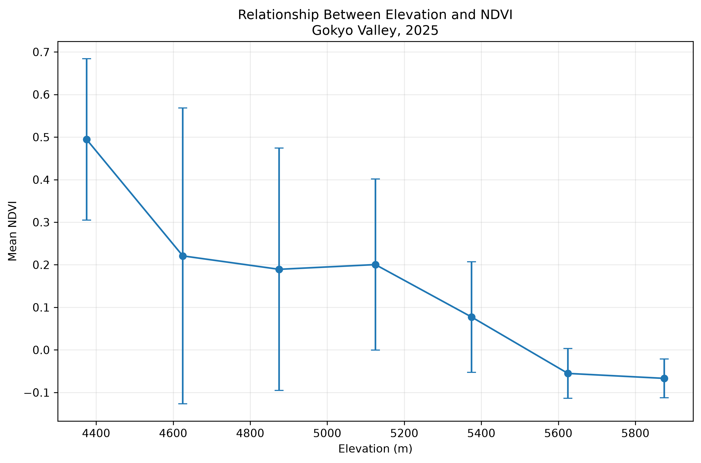
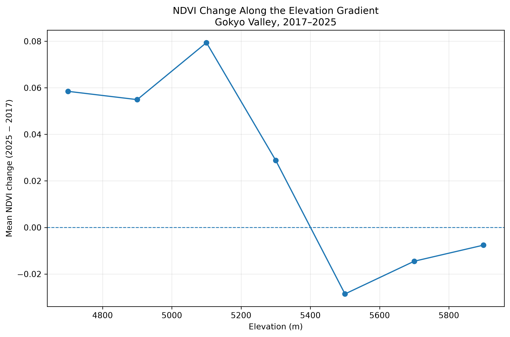
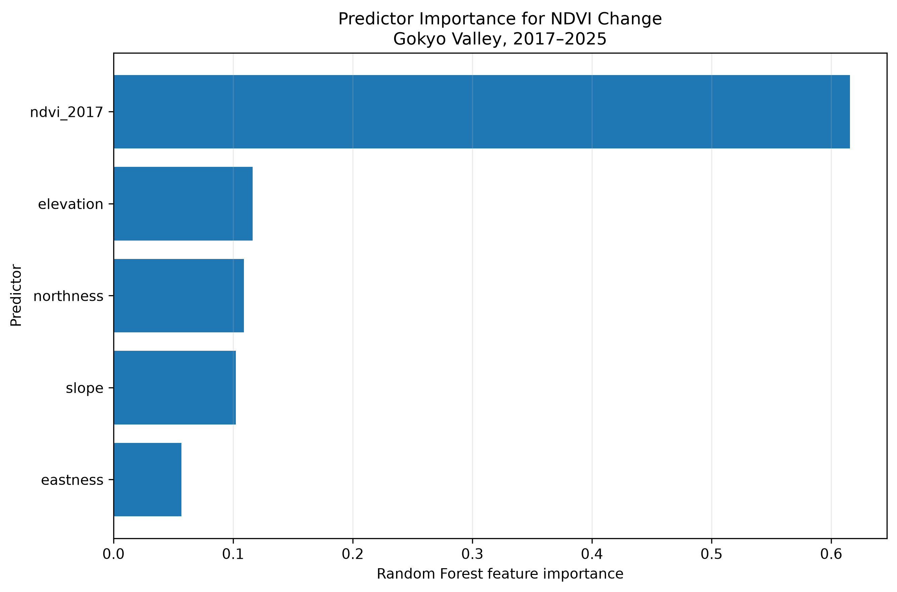

# Multi-Temporal Remote Sensing of Alpine Vegetation Dynamics in the Khumbu Himal, Nepal

## Overview

This project explores changes in alpine vegetation greenness in the Gokyo Valley, Khumbu Himal, Nepal, using Sentinel-2 imagery and terrain data.

The main questions are:

* How did NDVI vary between 2017, 2021, and 2025?
* How is NDVI related to elevation, slope, and aspect?
* Where did NDVI change between 2017 and 2025?
* Can terrain and baseline NDVI help explain the spatial pattern of change?

This is an exploratory remote-sensing and spatial-modelling project.

## Study Area

A compact research window was selected in the Gokyo Valley:

* Longitude: 86.65–86.74° E
* Latitude: 27.92–28.02° N
* Elevation: approximately 4,400–6,000 m

The coordinates define the research window used in this analysis and are not an official boundary.

## Data

**Sentinel-2 Surface Reflectance**

* Collection: `COPERNICUS/S2_SR_HARMONIZED`
* Years: 2017, 2021, 2025
* Seasonal window: September 1–November 1
* Scene cloud filter: <60%
* SCL-based pixel masking
* NDVI from B4 (red) and B8 (NIR)
* 10 m output resolution

**Elevation**

* Copernicus DEM GLO-30
* Used to derive elevation, slope, and aspect

More details: [`docs/data_sources.md`](docs/data_sources.md)

## Workflow

1. Prepare Sentinel-2 seasonal composites in Google Earth Engine.
2. Calculate annual NDVI.
3. Compare NDVI between 2017 and 2025.
4. Examine NDVI in relation to elevation, slope, and aspect.
5. Use Random Forest regression to explore spatial variation in NDVI change.
6. Evaluate the model using spatial cross-validation.

## Results

Mean NDVI across valid pixels:

| Year | Mean NDVI | Median NDVI |
| ---- | --------: | ----------: |
| 2017 |     0.097 |       0.086 |
| 2021 |     0.122 |       0.093 |
| 2025 |     0.169 |       0.123 |

For pixels valid in both 2017 and 2025:

* Mean NDVI change: **+0.052**
* Median NDVI change: **+0.024**
* 26.7% showed an NDVI increase >0.10
* 4.7% showed an NDVI decrease <−0.10

These represent changes in remotely sensed **vegetation greenness**, not vegetation cover or species abundance.

### Random Forest

The exploratory model predicted 2017–2025 NDVI change using baseline NDVI, elevation, slope, northness, and eastness.

* Random pixel holdout: R² = **0.663**
* Five-fold spatial cross-validation: mean R² = **0.506 ± 0.088**
* Mean spatial-CV RMSE = **0.0848 ± 0.0117**

The difference between random and spatial validation highlights the importance of spatially structured validation for environmental data.

Feature importance indicates that baseline NDVI contributed most to prediction, followed by elevation, northness, slope, and eastness. These are predictive associations, not evidence of causal relationships.

## Selected Figures









## Limitations

* Only two September–October scenes were available for 2017 after the selected filtering conditions.
* NDVI cannot distinguish willow from other vegetation.
* This project does not claim species-level willow mapping.
* Terrain relationships are associations, not causal effects.
* Spatial cross-validation provides a more conservative model assessment than a random pixel split.

## Reproducibility

```text
scripts/
├── 02_ndvi_analysis.py
├── 03_ndvi_change.py
├── 04_terrain_analysis.py
├── 05_slope_aspect_analysis.py
├── 06_change_terrain_analysis.py
├── 07_change_aspect_analysis.py
├── 08_random_forest.py
├── 09_spatial_validation.py
└── 10_spatial_cross_validation.py
```

Python dependencies are provided in `requirements.txt`.

Large raster datasets are excluded from the repository. The repository contains the analysis scripts, figures, result tables, and documentation.
